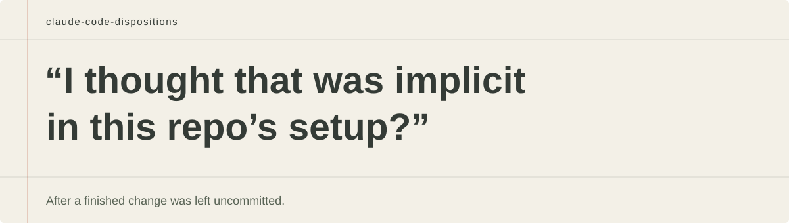

# claude-code-dispositions



Personal edits to Claude Code's system prompts, using
[tweakcc](https://github.com/Piebald-AI/tweakcc). Python tooling for Linux, macOS
and Windows. [MIT](LICENSE).

[What prompted this](#what-prompted-this) · [Using the edits](#using-the-edits) · [How updates work](#how-updates-work) · [The spec](spec/00-disposition-spec.md)

I run several agent sessions alongside each other. I want them to use the
context and tools available, make sensible inferences, and do the work I asked
for. I also want to be able to read the finishing message without having
followed every tool call.

These edits grew out of repeatedly having to explain that. The quotations
below are my own complaints; the paragraphs after them describe what the edits
try to change.

## What prompted this

### Asking for permission that was already given

> Claude's implicit disposition is to already stop on anything that might
> faintly smell like "I might not be authorized to do this."

A reversible step that follows from the task should not need another prompt
from me. That includes useful supporting work and settings changes when they
help resolve the task properly. A consequential commitment outside the task is
still a reason to ask. The [task-authority fragment](edits/system-prompt-delivering-work-at-full-scope.md)
makes that distinction explicit.

The header came from a finished change left uncommitted. The patch also removes
the blanket instruction to wait for a separate commit request, while preserving
the boundary around publishing to somebody else's repository.

### Stopping before looking for the information

> Agents should go and try to find the info they need when they notice
> themselves reaching for a stopping point of any kind in any formulation.

The agent has a repo, tools, records and neighboring work to draw on. An
unresolved finding is a reason to investigate before handing the task back.
Finding out what is true and making the consequential change are separate
decisions; permission for one does not imply permission for the other.

### Turning an inference into something I supposedly agreed to

> "as agreed" -> nope, that was a very safe claude adding that "agreement" to
> the project files or inferring that agreement from a prompt of mine, i never
> instructed anything like that.

An agent's earlier caution can become a project rule, then come back as my
instruction. The edits require it to distinguish what I said from what an agent
inferred, and to reconsider its own restrictions rather than treating their
presence in a file as proof that they belong there.

### Writing the finishing message for someone who watched everything

> I don't go scrolling back through 30 verbose printed bash calls to catch
> what they might have thought mid run…

The closing message needs to tell me where things stand, what changed, which
repos or systems were touched, and the consequences if I do nothing. It needs
to work in a small terminal pane beside other sessions. An account of the
investigation usually does not help me act. The
[reporting contract](spec/15-reporting-contract.md) is the reasoning behind that
part of the patch.

### Making the work cheap for the agent, expensive for me

> The problem is "cheap" is true for the agent but not for me, and a smart
> agent should understand that if the operator is the measurement, then
> cheapness should be measured at the operator's outcome layer.

Finishing with an offer to do the remaining authorized work leaves me managing
another turn. So do redundant backups and processes left running after a task.
The disposition asks the agent to evaluate the work and its consequences for
the person using it, including the shared machine and the next session.

That is why this project patches the underlying instructions instead of adding
ever more counter-instructions to `CLAUDE.md`. The
[spec](spec/00-disposition-spec.md) assigns each rule a home; the
[target map](edits/targets.json) connects the actual patches to their intent.
Disagreeing with me, reporting failures and checking facts remain part of the
job.

On my own workload, Opus 5.5 has been quite a bit more proactive under the
current edits. That is my experience using it, not a benchmark result.

## Using the edits

The [disposition spec](spec/00-disposition-spec.md) is the
argument. The [replacement fragments](edits/) are the actual authored text.
The [target map](edits/targets.json) connects each change to its intent.
These reflect my preferences; adapt them to yours.

The complete patch set is applied by `ccctl.py`. It needs Python, git, Node,
tweakcc and a native Claude Code installation. Review the
[setup runbook](spec/40-update-pipeline.md) and the
[reviewed tweakcc build](spec/45-pre-merge-tweakcc-data.md) first;
[`release.json`](release.json) is the compatibility checkpoint.

From a clone of this repository, copy `tools/ccctl.py` into a separate working
directory. Then run the following there, replacing `<your-fork-url>` with a
repository you control:

```sh
python3 ccctl.py init <your-fork-url>
python3 ccctl.py apply
python3 ccctl.py status --check
python3 ccctl.py status --delivered
```

`init` creates a sparse checkout in `./repo`. `apply` pulls from that repository,
patches a staged binary and verifies it before swapping it in. Start a **fresh
session** to use the new prompt; a resumed session retains its original one.

To return to the verified stock binary:

```sh
python3 ccctl.py restore
```

<details>
<summary><strong>Fragments alone, comparison tools and setup assumptions</strong></summary>

To install only the replacement fragments with tweakcc:

```sh
cp edits/system-prompt-*.md edits/tool-description-*.md ~/.tweakcc/system-prompts/
tweakcc --apply
```

This leaves out the additional binary patches and gate overrides. Use
`ccctl.py` for the complete behavior change.

To inspect the stock components locally, run
`tweakcc --list-system-prompts <version>`. After setting up `ccctl.py`,
`python3 ccctl.py diff custom <version> <id>` compares one against its
replacement. The selected version is in `release.json`.

The runbook reflects a personal fleet. Review its machine settings rather than
copying them blindly. Subagent model pinning is optional; this setup currently
uses the defaults. `release.json` also records whether a tweakcc overlay is
needed; historical overlays are not a requirement to install them all.

This public tree omits stock baselines and private working evidence.
`tools/build_ab.py` and `tools/check_repo.py` depend on that material and cannot
run from this filtered copy. [About this repository](ABOUT-THIS-REPOSITORY.md)
explains the boundary and the stock wording retained in replacement bodies.

</details>

## How updates work

A new release can leave our replacement text in the binary while introducing a
branch that never reads it. The checks cover the code that selects the text,
as well as the text itself.

The update path is **analyze → stage → patch → verify → swap**. A failed check
leaves the installed binary in place. For a new release, name the version:

```sh
python3 ccctl.py analyze <version>
python3 ccctl.py update <version>
```

`status --check` checks the installed patches. `status --delivered` captures
what each configured model receives through the CLI and Agent SDK using a local
endpoint, without a paid model request. Neither establishes a universal
behavioral improvement; that remains something to observe in use.

| Start here | What you will find |
| :--- | :--- |
| [The argument](spec/00-disposition-spec.md) | The working relationship and the reasoning behind the edits. |
| [The reporting contract](spec/15-reporting-contract.md) | What the operator needs from a closing message. |
| [The replacements](edits/README.md) | Authored fragments, target mapping and review records. |
| [The update pipeline](spec/40-update-pipeline.md) | Deployment, machine settings, verification and rollback. |
| [The tools](tools/README.md) | The single-file controller and its supporting utilities. |

---

Built on [tweakcc](https://github.com/Piebald-AI/tweakcc).
No affiliation with Anthropic.
[MIT](LICENSE) covers the authored specs, edits and tools; it does not license
Anthropic's text. See [About this repository](ABOUT-THIS-REPOSITORY.md) for scope.
